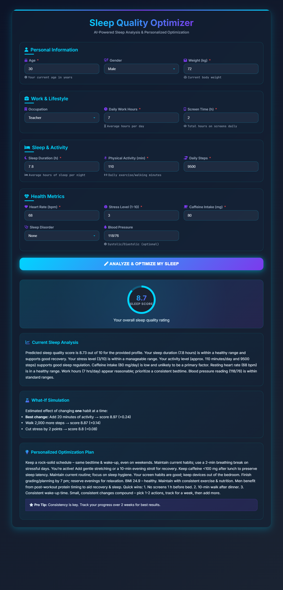
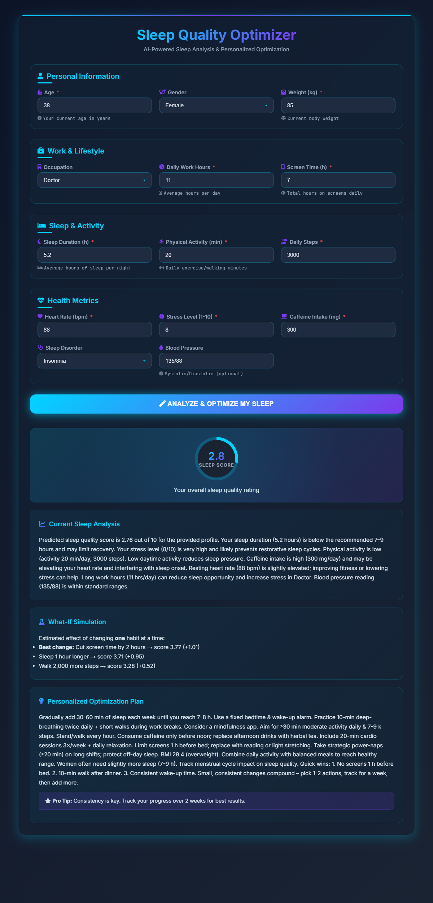
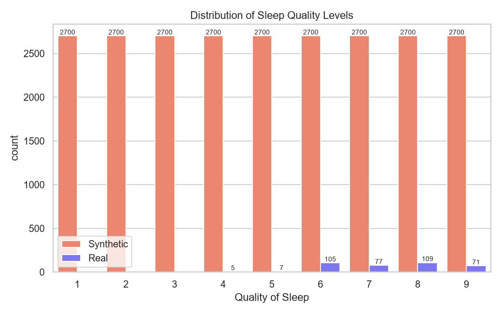
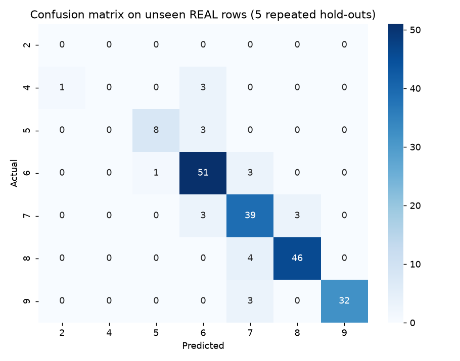

# Personalized Sleep Quality Consultant

An **AI-powered web app** that analyzes your daily habits and returns a personalized sleep consultation:
a predicted sleep-quality score, a breakdown of your habits, a "what-if" simulation and an action plan.
Built with **Python**, **scikit-learn**, **Flask** and a custom HTML/CSS/JavaScript front-end.

| Good sleeper | Poor sleeper |
|---|---|
|  |  |

## Key features

- **AI-powered prediction** of a sleep-quality score (1-9) from a Random Forest. The score is the probability-weighted
  average of the predicted classes, so it moves smoothly when a habit changes.
- **Detailed habit analysis** of sleep duration, stress, activity, heart rate, caffeine, work hours and screen time.
- **What-if simulation:** each lifestyle change is scored on its own (sleep +1 h, stress -2, caffeine -100 mg,
  screen time -2 h, ...) and the most effective ones are shown.
- **Customized action plan** based on your numbers and your occupation.

### How the score is computed

The model is a **classifier**: it outputs a probability for each quality class from 1 to 9. The number shown in the
app is **not** the single predicted class. It is the probability-weighted average of all classes:

`score = sum(class x probability of that class)`

Example: probabilities of 0.15 for class 2, 0.55 for class 3 and 0.30 for class 4 give `2x0.15 + 3x0.55 + 4x0.30 = 3.15`.

Why: the classes are ordered (3 is closer to 4 than to 9), and a smooth score lets the what-if simulation show the
effect of small changes (for example +0.9 for one more hour of sleep) even when the most likely class does not change.
Note that the accuracy figures below are for the predicted **class**, not for this averaged score.

## Project structure

```
├── config.py                # paths, feature lists, constants
├── run_pipeline.py          # data -> EDA -> training in one command
├── src/
│   ├── data_generation.py   # adds behavioural columns + generates synthetic records
│   ├── preprocessing.py     # loading, cleaning, encoding
│   ├── eda.py               # exploratory analysis figures
│   ├── train.py             # training + honest evaluation + saving the model
│   ├── predictor.py         # model loading, input validation, what-if simulation
│   └── advice.py            # rule-based analysis and action plan text
├── BackEnd/app.py           # Flask app (serves the UI and /predict)
├── FrontEnd/index.html      # user interface
├── data/                    # Sleep_dataset.csv (original), Final_DataSet.csv (generated)
├── Model/                   # RandomForest_Model.pkl, data_stats.json, metrics.json
└── img/                     # screenshots and figures
```

## Setup and run

```bash
git clone https://github.com/Eslamusamaaa/Sleeping-Quality-Prediction-Optimization.git
cd Sleeping-Quality-Prediction-Optimization
pip install -r requirements.txt
python BackEnd/app.py
```

Open `http://127.0.0.1:5000`. The trained model is included. To rebuild everything from the original dataset:

```bash
python run_pipeline.py
```

## Data

- `data/Sleep_dataset.csv`: the original dataset, 374 rows (only 132 are unique) with scores 4-9.
- Three behavioural columns were added: **Caffeine Intake**, **Daily Work Hours**, **Screen Time**.
- About 24,300 records were generated to cover the missing scores 1-3 and balance all nine classes.
  Every row carries an `Is Synthetic` flag, and generation is seeded, so the same file is produced every run.



More figures: [correlation heatmap](img/Sleeping-Quality-Prediction-Optimization/eda_correlation_heatmap.png),
[box plots](img/Sleeping-Quality-Prediction-Optimization/eda_boxplots.png),
[real vs synthetic](img/Sleeping-Quality-Prediction-Optimization/eda_real_vs_synthetic.png),
[feature importance](img/Sleeping-Quality-Prediction-Optimization/feature_importance.png).

## Model and honest evaluation

Random Forest (200 trees, depth 15) on 10 features. Because ~98% of the rows are synthetic, a random train/test split
mostly measures how well the model re-learns the data generator (93.8% accuracy). So the real rows are evaluated
separately: the model is tested on **real rows it has never seen** (5 repeated hold-outs of the unique real rows).

| Model | Accuracy | Within ±1 point | Mean abs. error |
|---|---|---|---|
| Synthetic rows only | 26.5% | 64.5% | 1.33 |
| **Synthetic + real rows (weighted) - used by the app** | **88.0%** | **96.5%** | **0.16** |
| *Random split of all data (inflated, for reference)* | *93.8%* | | |

Training only on synthetic data does not transfer to real people, which is why the real rows are added with a higher
sample weight. The hold-out sets are small (about 40 rows each), so treat the numbers as indicative.



### Limitations

- The synthetic rows are rule-generated; the model reflects those rules, not clinical sleep science.
- Scores 1-3 exist only in synthetic data, so they cannot be validated on real people.
- The advice texts are generic rules. **This is not a medical device** and does not diagnose sleep disorders.

## Real-world applications

The model uses inputs that wearables and phones already measure, so it can run as a small service behind many products:

| Where | How the model fits |
|---|---|
| **Smartwatches and fitness bands** (Apple Watch, Fitbit, Garmin, Samsung Galaxy Watch) | They already provide heart rate, steps, activity minutes and sleep duration. The model turns them into a daily sleep score and a "what should I change tonight" suggestion on the watch or companion app. |
| **Smartphone health apps** | Screen time comes from Digital Wellbeing / Screen Time, and the rest from the Health apps. A morning notification shows the score and the best what-if change. |
| **Smart beds, mattresses and smart home** | A sleep score can drive routines: dim lights and lower the thermostat earlier when the what-if shows that sleeping 1 hour longer helps most. |
| **Corporate wellness programs** | Aggregated, anonymous scores show which teams are at risk (long hours, high stress, high caffeine) so schedules can be adjusted. |
| **Shift workers: hospitals, transport, factories** | Nurses, doctors and drivers have irregular schedules. The occupation-specific plan and long-hours analysis help managers reduce fatigue-related risk. |
| **Telehealth and clinics** | A screening aid before a visit: patients fill the form and the doctor sees habits that may hurt sleep (a first look, not a diagnosis). |
| **Universities and student apps** | Students with high screen time, stress and low sleep get early reminders around exam periods. |
| **Sleep coaching chatbots** | The prediction and what-if results can feed a coaching conversation with concrete numbers. |

Before any real deployment: validate on a larger real dataset, collect user consent, store health data securely,
and present the output as wellness guidance, not medical advice.

## Tech stack

| Layer | Technologies |
|---|---|
| Backend and ML | Python, Flask, scikit-learn |
| Data | pandas, numpy |
| Visualization | matplotlib, seaborn |
| Frontend | HTML, CSS, JavaScript |
| Model persistence | joblib |

## License

MIT License
